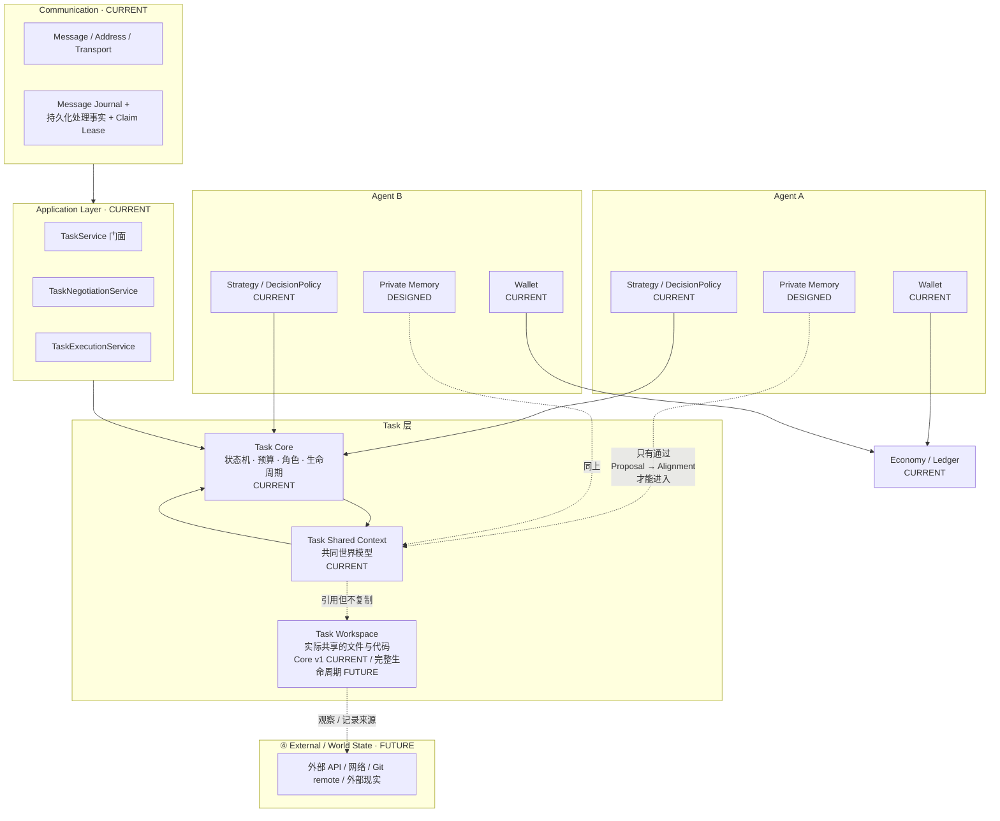

# AI Economy OS — Architecture Constitution

> **这份文档是 AI Economy OS 的长期架构 Source of Truth。**
>
> 它回答的不是「代码现在长什么样」（那是代码自己的事），而是
> **「这个系统是什么、为什么这样设计、哪些边界不许越过」**。
>
> 任何一个新的开发者（人或 AI Coding Agent）在动代码之前，
> 都应该先读完这份文档 + [`AGENTS.md`](../../AGENTS.md)。

| | |
|---|---|
| **文档状态** | 长期维护（不是一次性报告） |
| **当前阶段** | Post-Change-Pipeline-Phase-1 · Agent Core V1 · Tool Runtime V1 · Vision Perception V1 · Demand Entry V1 · Workspace Read/Edit/Search V1 已实现 |
| **协议版本** | `protocol_version = "1"` |
| **基线测试** | 以 `./dev.sh test` 当前输出为准（最近：5590 passed, 2 skipped, 30 deselected） |
| **最后更新** | 文档对齐（Step 4F / Workspace Core v1 / Agent Core v1） |

---

## 0. 怎么使用这份文档

### 0.1 它是规范，不是介绍

README 告诉你「怎么跑起来」。这份文档告诉你
**「当前能力是什么、边界在哪里、以及为什么」**。

冲突时以这份文档为准；如果代码与这份文档矛盾，
**要么改代码，要么先改这份文档并说明理由** —— 文档与代码必须显式对齐。

### 0.2 四态标注纪律（强制）

这份文档里每一条关于系统的陈述，都必须能归入下面四态之一。
**把未来设计写成「现在已有」是本项目最严重的文档错误。**

| 标记 | 含义 | 例子 |
|---|---|---|
| **`CURRENT`** | 代码里**已经实现**，有测试 | `TaskWorkspaceRef` 存在 |
| **`DESIGNED`** | 已经设计清楚，**尚未实现** | Workspace Permission |
| **`FUTURE`** | 方向明确，但还没有设计 | P2P / 多机 |
| **`FORBIDDEN NOW`** | 当前阶段**尚未解锁**，需要任务书 | Task Payment、P2P |

> **本项目的真实例子（必须照此写）**：
>
> ✅ 正确：「`CURRENT` — 任务通过 `TaskWorkspaceRef` 持有一个
> `workspace_id`。它只是逻辑引用。」
>
> ❌ 错误：「系统已经存在完整的 Workspace Permission。」
>
> 后半句把 `DESIGNED`/`FUTURE` 写成了 `CURRENT`。这会直接误导
> 下一个开发者去调用一个不存在的 API。

### 0.3 导航

| 我想知道… | 去哪 |
|---|---|
| 项目是什么、当前做到哪、怎么开发 | [`AGENTS.md`](../../AGENTS.md) |
| 为什么这样设计、边界在哪 | **本文档** |
| Task Shared Context 的数据模型 | [`TASK_SHARED_CONTEXT.md`](TASK_SHARED_CONTEXT.md) |
| 某个具体架构决策的历史与理由 | [`adr/`](adr/README.md) |
| 怎么跑命令 | [`COMMANDS.md`](../../COMMANDS.md) |
| 消息协议的具体形状 | [`PROTOCOL.md`](../../PROTOCOL.md) |

---

## 1. AI Economy OS 是什么

### 1.1 四个定义性特征

这四点决定了架构选择：

- **长期运行的经济主体**：系统的中心是 Agent，而不是「一个会话」。
- **可重复运行的生产系统**：不是把几个 Agent 并排跑一遍的演示。
- **LLM 是外部生产资源**：模型是 Agent 使用的资源之一，不是系统本身。
- **Agent 是独立主体**：不是脚本批次里的一个执行步骤。

### 1.2 它的长期目标

> 一个可以从**单机双 Agent**，逐步演化为**多 Agent、多机器、跨网络**，
> 具有**独立身份、能力、记忆、经济行为和自主协作能力**的
> **Agent Operating Environment / Economy System**。

### 1.3 演进方向

```
单机
  ↓
双 Agent          ← 当前已经在这里
  ↓
多 Agent
  ↓
多进程            ← CURRENT（Workspace Phase 0 已验证）
  ↓
多机器
  ↓
跨网络
  ↓
P2P / Distributed Agent Network
```

**V1 只实现当前阶段。** 架构为最终形态**保留演进空间**；
走向多机 / 跨网络的每一步都由独立任务书解锁。

### 1.4 为什么「经济」是关键

这个项目与其他 Multi-Agent 系统的根本区别是：

> **Agent 是独立的经济主体，不是被调用的函数。**

它有**自己的**钱包、**自己的**议价策略、**自己的**判断。
它可以：
- 决定**接不接**一个任务
- 决定**报什么价**
- 决定**拒绝**
- 决定**外包**给别的 Agent

系统的职责与 Agent 的自主决定分开：

| 系统负责 | Agent 自主决定 |
|---|---|
| 协议 | 怎么谈价 |
| 状态 | 是否接受某个价格 |
| 业务硬约束 | 是否信任另一个 Agent |
| 持久化 | |
| 消息路由 | |

这条分界贯穿整个架构，是**最重要的一条设计原则**。

---

## 2. Agent 的正式定义

### 2.1 Agent 不是「LLM + Prompt」

`CURRENT`（部分）/ `DESIGNED`（整体）—— 一个 Agent 是一个**长期运行的主体**：

```
Agent
├── Identity            身份（我是谁）                    CURRENT
├── Address             地址（在哪里能找到我）             CURRENT
├── Capability          能力（我会做什么）                 CURRENT
├── Brain / Decision    决策（我怎么办）                   CURRENT
├── Private Memory      私有记忆（我经历过什么）           DESIGNED
├── Economy             经济环境（我在什么经济系统里）      CURRENT
├── Wallet              钱包（我有多少钱）                 CURRENT
├── Strategy            策略（我的偏好与底线）             CURRENT
├── Private Workspace   私有空间（我自己的文件）           CURRENT（访问边界）
└── Runtime / Life Loop 运行时（我什么时候醒来）           FUTURE
```

> **`Private Memory` 的标注是 `DESIGNED`。**
> Memory 指**经验积累**；Agent 的配置（`config.yaml`）是**静态声明**，
> 与 Memory 属于不同层。

### 2.2 最常被搞混的五个不等号

`Identity ≠ Address` · `Capability ≠ Permission` · `Wallet Ownership ≠ Machine Permission`
的完整定义见 §3 原则表。

`Economy ≠ Intelligence`：经济表现是外部信号，不是能力评分。
`Private Memory ≠ Shared Task Context`：私人判断需经 `Proposal → Alignment`
才成为共识（§6.2 / §8）。

---

### 2.3 Agent / World / Asset / Capability 的十个不变量（`CONFIRMED`）

> **正式冻结于 [ADR-0038](adr/0038-agent-world-core-boundaries.md)。**
> 完整语境见 [`AGENT_CORE_MODEL_V1.md`](AGENT_CORE_MODEL_V1.md)。
>
> ⚠️ **这些是 Architecture Invariants（架构不变量），不是实现方式。**
> 它们说的是「概念之间不能相等」，因此不受具体实现选型影响。

| # | 不变量 | 搞混的后果 |
|---|---|---|
| 1 | `Agent Identity ≠ Runtime` | 进程重启就换了个 Agent；Runtime 状态被当成主体 |
| 2 | `Agent Identity ≠ LLM` | 换模型就换身份；把智力来源当成主体 |
| 3 | `Agent Identity ≠ Provider Account` | 同一个账号下的 Agent 被当成同一个主体 |
| 4 | `Agent Identity ≠ API Credential` | 换一把 key 就换了身份 |
| 5 | `Agent Identity ≠ Workspace` | 删掉目录就等于消灭 Agent |
| 6 | `Agent Identity ≠ Capability` | 拥有身份就自动拥有一切能力 |
| 7 | `Agent-owned Assets ≠ Machine Permissions` | 有资产就自动有机器权限 |
| 8 | `Task Responsibility ≠ Agent Identity` | 用任务归属反推 Agent 是谁 |
| 9 | `World ≠ Agent` | 把环境的状态当成主体的记忆 |
| 10 | `Private Workspace ≠ Task Workspace` | 私有资产与共享资源混成一个空间 |

**地基**（[`AGENT_CORE_MODEL_V1.md`](AGENT_CORE_MODEL_V1.md) §1）：

> **Agent 是一个持续存在的数字主体（persistent digital subject）。**

第 1–6 条都是它的直接推论 —— **载体、工具、环境会变，主体不变。**
第 7 条与 §2.2 的 `Wallet Ownership ≠ Machine Permission` **同源**。
第 10 条与 §4.1 的 Memory 边界一致。

> 🔒 **`Capability` 不是 `Permission`。**
> 它是 **Agent 与 World 之间进行感知与行动的受控接口**
> （分 `Perception` / `Action` 两类）。
> `Authorization` 决定能否获得/使用，但 **`Authorization ≠ Capability`** ——
> 授权是门禁，Capability 是器官。
>
> 🔒 `Gateway` **是** Agent 与 World 之间的接口层；
> 但它与 Capability 的**代码关系不冻结**（继续 `PROVISIONAL` / `OPEN`）。

---

## 3. 核心原则清单

**这十四条是项目的架构骨架。** 每一条都对应代码里的一个真实边界，
并且大部分有**架构守卫**在自动检查（见 §12）。

| # | 原则 | 当前由什么保证 |
|---|---|---|
| 1 | `Identity ≠ Address` | `core/identity.py` + `communication/address.py` 分离 |
| 2 | `Message ≠ Transport` | `communication/message.py` vs `transport.py` |
| 3 | `Communication ≠ Business Logic` | 守卫：`communication/` 不许 import `core.task` |
| 4 | `Capability ≠ Permission` | `core/capability.py` 是纯集合运算；守卫检查它不接触权限 |
| 5 | `Capability ≠ Economy` | Capability 不认识钱包/账本 |
| 6 | `Wallet Ownership ≠ Machine Permission` | Wallet 不提供任何文件/执行能力 |
| 7 | `Task Core ≠ Task Manager` | 系统不含 `TaskManager` / `Coordinator`；有守卫检查 |
| 8 | `Task Shared Context ≠ Message History` | **`CURRENT`** —— 结构上保证（对齐层不认识 Message） |
| 9 | `Task Shared Context ≠ Agent Private Memory` | **`CURRENT`** —— 无读写私有记忆的路径 |
| 10 | `Task Shared Context ≠ Task Workspace` | **`CURRENT`** —— 零文件系统访问 |
| 11 | `Workspace ≠ Permission` | `workspace_id` 只是逻辑引用；守卫检查无宿主机文件 I/O |
| 12 | `Memory ≠ Alignment` | **`CURRENT`** —— 领域层与 Alignment 层分离（ADR-0019） |
| 13 | `Agreement ≠ Payment` | `TaskAgreementRecord.describe()["is_payment"] == False` |
| 14 | `Budget ≠ Price` | `Task.budget` 与 `Task.agreed_price` 是两个字段 |

补三条从经验里长出来的：

| # | 原则 | 含义 |
|---|---|---|
| 15 | `DecisionPolicy ≠ Decision Execution` | 策略只**返回**决定，不执行 |
| 16 | `Domain ≠ Infrastructure` | `core/` 不依赖 `services/`；应用层经 `core/task_store` 访问存储 |
| 17 | `Task Execution ≠ Code Execution` | 生命周期推进不跑代码；代码/测试只经 Tool Runtime |

---

## 4. 架构全景图

### 4.1 分层



**看图的三条要点**：

1. **Private Memory 到 Shared Context 是虚线**：路径是
   `Proposal → Alignment`（§8）。
2. **Shared Context 到 Task Workspace 是虚线** —— 前者说「我们认为是什么」，
   后者说「实际有哪些文件」。两者关联但不相等。
3. **只有 Application Layer 能改 Task** —— Communication 送消息，
   但它不认识 Task（§11.2）。

### 4.2 依赖方向（单向，无环）

```
agents/         → core/ + llm/
services/       → core/ + communication/     ← 不直接依赖 storage/
communication/  → core/ + storage/
core/           → storage/ 叶子 + agents/
storage/        → core/ 叶子（paths / logging_setup / config）
llm/            → core/ + storage/
tool_runtime/   → core/ + 标准库（subprocess）；不依赖 services/
```

**守卫保证**：
- `core/` 与 `communication/` 不 import `services/`
- `services/` 不直接依赖 `storage/`（经 `core/task_store`）
- 只有 `main.py` 能调用 `register_type_handler`（接线只能在组合根）
- 两个已知例外：`core/economy.py → agents/base_agent.py`；
  `storage/database.py` 函数内 import `core.config`

---

## 5. Agent 的核心组成详解

### 5.1 Identity（`CURRENT`）

> **我是谁。**

`AgentIdentity` —— 稳定、不可变、与位置无关。
它是**经济主体**的身份：钱包挂在它下面，账本按它记账。

### 5.2 Address（`CURRENT`）

> **在哪里能找到我。**

`Address` 是 `scheme://identifier` 形式（本地、未来的 P2P 等）。
**搬家不换身份**：Address 可以变，Identity 不变。

### 5.3 Capability（`CURRENT`）

> **我会做什么。**

`CapabilityProfile` 是能力的**集合**。
它只支持集合运算（`covers` / `missing` / `union`…）。

**Capability 只表达技能集合**；评分、排名、信誉、价格属于
Agent Strategy 或未来的经济信号。「谁会做」和「谁最合适 / 谁最便宜」
是两个不同的问题。

### 5.4 Brain / Decision（`CURRENT`）

> **我怎么办。**

两条决策路径职责不同：

| | Brain | DecisionPolicy |
|---|---|---|
| 用在哪 | **执行阶段**（怎么写代码、怎么分析） | **议价阶段**（接不接、报多少） |
| 是否调 LLM | 是（这是 LLM 的用武之地） | **否**（确定性本地规则） |
| 为什么 | 任务内容需要智能 | 谈判成本必须低于任务价值 |

`CURRENT` —— 议价策略是 `RuleBasedDecisionPolicy`：
接受线 / 开口价 / 底线 / 最大轮数，参数来自**每个 Agent 自己的 config**。

> **`DecisionPolicy` 只返回 `Decision`，不执行它。**
> 把它落到状态上的是 `TaskNegotiationService`。
> 有守卫检查策略不直接 import 钱包/账本/通信/文件系统。

### 5.5 Economy / Wallet（`CURRENT`）

> **我在什么经济系统里 / 我有多少钱。**

**账本是唯一事实来源，余额永远是算出来的**
（`SUM(inflow) - SUM(outflow)` 按 `asset` 过滤）。
`wallets` 表只保存资产引用，**余额由账本派生**，避免余额与账本漂移。

货币代码是 `AIC`（AI Coin）。

### 5.6 Strategy（`CURRENT`）

> **我的偏好与底线。**

对 Agent 而言，strategy **就是它的经济参数**：
最低可接受价格、目标价格、风险偏好、时间压力……

**它属于 Agent 自己**，不属于系统。
Agent 特定参数来自配置 / Strategy；代码保持 agent-agnostic —— 有守卫。

### 5.7 Private Memory（`DESIGNED`）

> **我经历过什么。**

见 §6 Layer 1。**当前尚未实现。**

### 5.8 Private Workspace（`CURRENT`：访问边界）

> **我自己的文件。**

`core/workspace.py` 提供每个 Agent 的私有目录访问边界
（路径越界会抛 `WorkspaceViolationError`）。它与 Task Workspace **不同**；
ACL / 授权体系仍是 `FUTURE`。

### 5.9 Runtime / Life Loop（`FUTURE`）

> **我什么时候醒来。**

Heartbeat / 事件唤醒 / 自主循环属于 `FUTURE`。
V1 的生命周期由显式调用与消息驱动。

---

## 6. Memory 四层架构

> **这是 Step 4E 的核心架构决策。**

### 6.1 全景

| Layer | 名字 | 属于谁 | 状态 | 是不是 Source of Truth |
|---|---|---|---|---|
| **1** | Agent Private Memory | **单个 Agent** | `DESIGNED` | 不是 |
| **2** | Task Shared Context | **Task** | **`CURRENT`** | ✅ 是（任务知识层） |
| **3** | Task Workspace | **Task** | **Core v1 `CURRENT`** · 完整模型 `FUTURE` | ✅ 是（实际产物层） |
| **4** | External / World State | **系统外** | `FUTURE` | ✅ 是（但需记来源） |

### 6.2 Layer 1：Agent Private Memory

**属于单个 Agent。** 用于：

- 个人经验、历史经验、偏好
- 私人知识、私人推理缓存
- 经济经验、谈判策略
- 技能经验
- **对其他 Agent 的私人评价**
- 私人规划

**三条硬规则**：

1. **读取边界**：默认只有 owner 读取。
2. **权威边界**：它不是系统事实的 Source of Truth。
3. **升级路径**：进入 Shared Context 必须经 `Proposal → Alignment`。

> **例子（必须照此理解）**：
>
> Agent B 私下认为「Agent C 不太可靠」。
> 这属于 **Private Memory**。
>
> 如果 B 想让它影响协作，需要走正式流程提出（见 §8）；
> 在此之前，它只是 B 的私人判断，而不是团队共识。

### 6.3 Layer 2：Task Shared Context

**属于 Task，不属于任何 Agent。**

它维护「多个参与 Agent 当前共同使用的 **Task World Model**」。

**它应该包含**：

| 类别 | 说明 |
|---|---|
| Objective | 这个任务要达成什么 |
| Constraints | 约束（预算、时间、技术限制） |
| Acceptance Criteria | 什么算通过 |
| **Decisions** | **已共同确认的决定** |
| **Assumptions** | **暂时假设（未确认）** |
| **Open Questions** | **当前还不知道什么** |
| **Assignments** | **谁负责什么** |
| Current Status | 当前进展 |
| Relevant Facts | 已确认的事实 |
| Terminology | 术语约定 |
| Verification Feedback | 验收意见 |
| Shared Artifacts References | 共享产物的**引用**（不是产物本身） |

> 🔒 **它不是一个 `shared_memory.txt`。**
>
> 它必须具有：`revision` · `provenance` · `change history` ·
> `authority` · `source` · `status` · `alignment semantics`。
>
> 详细数据模型见 [`TASK_SHARED_CONTEXT.md`](TASK_SHARED_CONTEXT.md)。

### 6.4 Layer 3：Task Workspace

**回答**：实际共享了**什么数据和代码**？

未来可能包含：source code · files · tests · patches ·
generated artifacts · worktrees。

`CURRENT`（Workspace Core v1）—— 已实现资源树、Controller、
Explicit/Effective Lock、Revision、Audit、Event、Gateway 与资源级并发。
`TaskWorkspaceRef` 仍然只是逻辑引用；完整的 Task Workspace 生命周期
（Patch / Test / Acceptance）仍是 `FUTURE`。

> **Workspace ≠ Shared Context**
>
> - Shared Context：「我们**认为**这个任务现在是什么」
> - Workspace：「**实际**有哪些东西」
>
> 一个说决定用 parser B，另一个是 `parser.py` / `tests/` / `fixtures/`。
> 两者相互关联，但职责不同。

### 6.5 Layer 4：External / World State

例如：外部 API · 网络 · 外部数据库 · Git remote ·
外部服务 · 外部现实环境。

**一条硬规则**：External State 进入 Shared Context 时需要**记录来源**并经过确认；
观察首先是一条 Observation，而不是既成事实。

> 为什么：如果一个 Agent 说「我查了，那个 API 支持幂等」，
> 这句话在进入共同模型之前**只是一个观察**，
> 而不是**经过确认的事实**。

---

## 7. Memory ≠ Alignment

> **这是本阶段最重要的区分之一。**

| | 回答的问题 | 是什么 |
|---|---|---|
| **Shared Context** | 我们共同认为现在是什么 | **结果 / 状态** |
| **Alignment** | 我们**如何**形成、确认、修改、争议、废弃共同信息 | **机制 / 过程** |

**Shared Memory 只是「存储共同信息」。**
**Alignment 是「多个 Agent 如何就共同信息达成一致」。**

```
Shared Context   ≠   Alignment Protocol
    （结果）              （产生和更新结果的机制）
```

**为什么必须分开**：

如果只有「共同存储」而没有「形成机制」，那么：

> 任何一条消息都可能悄悄变成「共同事实」。
> 那等于**没有共识，只有最后说话的人**。

---

## 8. 「说过」≠「确认过」

> **这是未来多 Agent 一致性的核心。**

### 8.1 边界例子

```
Agent A 说：「我觉得我们应该用方案 B。」

Communication History：✅ 存在这句话
Task Shared Context： 还没有 Decision Record
```

此时状态是「A 提出过一个建议」，还不是「团队已经决定方案 B」。

### 8.2 正确的路径

```
Proposal
    ↓
Alignment
    ↓
DecisionRecord
    ↓
Shared Context Revision
```

**只有走完这四步，才算「共同决定」。**

### 8.3 Alignment Protocol 的基本模型

`DESIGNED` —— 先设计，不实现完整协议。

```
Agent A
   ↓  PROPOSE_CHANGE
Task Shared Context
   ↓  Validation / Alignment
Agent B
   ↓  ACCEPT / DISPUTE
Context Revision
```

### 8.4 四类变更：对齐强度按类型区分

> Shared Context 使用 **authority + provenance + revision + conflict handling**。
> 不同变更类型采用不同对齐强度；复杂 quorum / blockchain consensus
> 不属于 V1 模型。

| 类型 | 例子 | 谁决定 | 需要对齐吗 |
|---|---|---|---|
| **自动事实** | `Task.status` | **Domain State** | 不需要（客观事实） |
| **契约约束** | 预算、验收要求 | Task / Agreement / User input | 由 Task / Agreement 决定 |
| **协作决策** | 「选择方案 B」 | **需要明确的对齐机制** | ✅ 需要 |
| **个人信念** | 「我觉得 C 不可靠」 | —— | 留在 **Private Memory** |

### 8.5 冲突怎么办

`DESIGNED` —— 当前只定义原则：

1. **Domain State 优先** —— 如果 Shared Context 与 Task 状态矛盾，
   以 Task 为准，并把 Shared Context 标记为需要修正。
2. **历史保留** —— 旧 Decision 被取代时标 `SUPERSEDED`，旧版本继续可查。
3. **记录争议** —— 如果两个 Agent 无法达成一致，那本身是一个
   **Open Question / Dispute**，而不是「谁先写谁赢」。

---

## 9. Source of Truth

### 9.1 权威优先级（正式定义）

```
Domain State / TaskAgreement
        >
Task Shared Context
        >
Communication History
        >
Agent Private Memory
        >
Agent Inference
```

### 9.2 每一层的含义

| 层 | 含义 | 例子 |
|---|---|---|
| **Domain State / Agreement** | **系统客观事实** | `Task.status` · `agreed_price` · `contractor` · `task_id` |
| **Task Shared Context** | **共同确认**的任务知识 | DecisionRecord · 已确认的 Fact |
| **Communication History** | **过去说过什么** | Message Journal |
| **Agent Private Memory** | **个体**的判断与经验 | 「我觉得 C 不可靠」 |
| **Agent Inference** | **推测** | 「他大概会拒绝」 |

### 9.3 三条推论

1. **Domain State 的权威高于 Agent Memory。**
   如果账本说成交价是 25 AIC，当前事实以账本为准。

2. **Communication History 是历史。**
   当前是否有效，以 Domain State / Shared Context 为准。

3. **Inference 必须显式标记为推测。**
   推测与事实在数据结构上分开。

---

## 10. Context Snapshot

`DESIGNED` —— 先定义概念和边界，**不实现**。

### 10.1 它解决什么问题

> **Agent 每次执行 Task 时，不可能把整个历史加载进 LLM context。**

```
Message 1
Message 2
...
Message 500     → LLM context 装不下，而且大部分是噪音
```

### 10.2 它是什么

**Shared Context 在某个时间点、给某个 Agent 的「可消费视图」。**

它是**派生物**，**不是新的 Source of Truth**：

```
Snapshot #42

Objective:            ...
Current constraints:  ...
Current decisions:    ...
Open questions:       ...
Your assignments:     ...
Latest verification feedback: ...
Relevant artifacts:   ...
```

### 10.3 固定边界

- Snapshot 是 Shared Context 的**派生视图**，Source of Truth 仍在 Shared Context。
- V1 不做自动 LLM summarization。
- Snapshot 必须带 `revision`，标明它是哪一刻的视图。

---

## 11. 各层职责与边界

### 11.1 Task Core（`CURRENT`）

**负责**：状态 · 状态机 · 预算 · 角色 · 生命周期 · Task identity · 报价历史。

**不负责**：消息（`Message`）· 传输 · 目录（`AgentDirectory`）·
LLM · 网络 · 通信日志 · 应用服务。

> **Task Core 不依赖 Communication** —— 有守卫。
> 任务怎么改状态是领域规则；消息怎么送达是通信的事。

### 11.2 Communication（`CURRENT`）

**负责**：Message · Address · Identity · Transport · Delivery ·
协议 · Message Journal · **持久化的处理事实** · Claim Lease。

**不负责**：Agent 是否接受价格 · Task 是否 ACCEPTED ·
Agreement 是否成立 · Task 是否 VERIFIED。

> **通信层保持业务无关**：守卫检查 `budget` 等业务词不出现。
> 它只负责把消息送到；「这个价格允不允许」是业务问题。

### 11.3 Application Layer（`CURRENT`）

`services/` —— **消息与领域之间的适配层**。

```
Message
   ↓
TaskService（薄门面 / 路由）
   ↓
Handlers（按消息类型）
   ├──→ TaskMessageMapper        协议 payload ↔ 应用数据
   ├──→ TaskNegotiationService   议价规则 + 状态落地
   └──→ TaskExecutionService     执行规则 + 状态落地
```

**议价与执行分开**（Step 4D 的核心决定），因为它们的**变化原因不同**：

| | 变化原因 |
|---|---|
| **议价怎么谈** | 会随着 Agent 的智能程度不断演化 |
| **执行怎么走** | 由协议和状态机固定 |

混在一起就会出现「想改议价策略时得动执行代码」。

### 11.4 Negotiation（`CURRENT`）

**负责**：OFFER · COUNTER_OFFER · ACCEPT · REJECT ·
报价历史 · 谈判轮次 · 成交凭证（TaskAgreement）。

**不负责**：执行。

`Agent Strategy` **不在这一层** —— 它在 Agent 自己的 `DecisionPolicy` 里。

### 11.5 Execution（`CURRENT`）

**负责**：START · SUBMIT · VERIFY · COMPLETE 的校验与状态落地。

**职责边界**：Execution 只负责推进生命周期；
代码执行由 **Tool Runtime** 负责，LLM 调用、资金、Workspace、Git 由其他层或未来阶段负责。

> **4D 的「执行」指的是任务生命周期进入执行状态，
> 不是「系统替 Agent 跑代码」。**

### 11.6 Economy（`CURRENT`）

**负责**：Agent · Wallet · Ledger · 余额计算 · 审计 · 转账。

**不负责**：任务 · 消息 · 策略。

> `Agreement ≠ Payment`：`TaskAgreementRecord` 记录**约定了什么**，
> **不是**支付记录。它有 `is_payment: False` 的显式声明。
> 结算是一个**独立的后续阶段**。

### 11.7 与 Shared Context 的边界（`DESIGNED`）

| 相邻层 | 边界规则 |
|---|---|
| **Private Memory** | 默认仅 owner 可读写；进入共享层的路径是 `Private Observation → Proposal → Alignment → Shared Context` |
| **Workspace** | Shared Context 说「认为是什么」，Workspace 说「实际有什么」；两者相互关联、职责不同 |
| **Communication** | `Message → 可能的 Context Proposal → Alignment → Context Revision`；消息本身不自动写 Shared Context |
| **Task Core** | **Task Core 是 Domain State 的唯一权威；Shared Context 引用并解释它。** `status` / `agreed_price` / `contractor` 由 Task Core 维护，避免两边漂移 |
| **Economy** | 只保存**与这个 Task 相关的、需要共同知道的**经济事实（如 `agreed_price`，来自 `TaskAgreement`）。**Agent B 的全部余额不属于 Shared Context** |

### 11.8 Tool Runtime（`CURRENT` V1）

**负责**：在独立 run 目录执行**公共工具库**中的 allowlist 工具
（python / pytest / node / playwright），把 stdout / stderr / exit code
结构化返回给 Agent。

**不负责**：Task 生命周期、消息协议、钱包/账本、Task Workspace revision、
任意 shell、任意下载/安装。详细设计：[`TOOL_RUNTIME_V1_DESIGN.md`](TOOL_RUNTIME_V1_DESIGN.md)，
决策：[ADR-0040](adr/0040-controlled-code-execution-tool-runtime.md)。

---

## 12. Guard 规范

> **Step 4E 之前，本项目已经出现过多次「守卫本身有问题」。**
> 这一节记录真实教训，帮助后续开发者避免重复发生。

### 12.1 当前守卫现状（`CURRENT`）

守卫文件位于 `tests/*guards*.py`，覆盖 Capability、Communication、
Execution、Multiprocess、Negotiation、Reliability、Service Layer、Task Core
等边界。具体项数随测试演进，以 `./dev.sh test` 当前输出为准。

### 12.2 检测手段优先级（**强制**）

**优先使用**：

1. **AST**（`ast.parse` / `ast.walk` / `ast.unparse`）
2. **import 图**（谁 import 谁）
3. **真实调用点**（`conn.execute(...)` 的参数，而不是文件里有没有这个词）
4. **具体的 DB 写入**（`UPDATE x SET y`，而不是「含 UPDATE」）
5. **运行时行为**（`hasattr`、真的跑一遍看不变量）

**字符串扫描作为最后手段**：它容易被注释、文档字符串、变量名误导：

```python
source.count("xxx")        # 可能被注释、文档字符串、变量名骗到
```

### 12.3 如果必须做字符串扫描

三条**强制**要求：

1. **去掉文档字符串**（`ast.unparse` **不会**帮你做这件事）
2. **明确扫描范围**（是「整个文件」还是「某个方法体内」）
3. **做反向测试**（把违规注入进去，确认守卫真的变红）

### 12.4 本项目的真实教训（建议阅读，避免重复踩坑）

#### 教训 A：子串匹配会误报（至少 4 次）

```
seen_tracker      含 "ack"
offer_amounts     含 "mount"
is_open           含 "open"
agent_directory   含 "agent_d"     ← 最阴的一次：它是 agent_d + irectory
```

**对策**：检查标识符要**按词切分**，或匹配**带引号的完整字面量**。

#### 教训 B：文档字符串不是代码（至少 8 次）

文档里会**合法地**写：

```markdown
❌ 不 import llm
❌ 不执行代码（没有 subprocess）
绝对不许写 `if agent_id == "agent_b": ...`
registry.register(SubmitHandler(negotiation))     ← 只是举例
```

如果守卫查原文，就会被自己的说明文字绊倒。

**对策**：`code_only()` —— 先删掉文档字符串节点，再 `ast.unparse`。

#### 教训 C：守卫查错了对象（至少 3 次，**都是假绿**）

| 假绿 | 为什么绿了 |
|---|---|
| `assert "claim_message" in code` | 方法自己就叫 `_claim_message` —— 名字永远都在 |
| `assert "BEGIN IMMEDIATE" in source` | 文档里为了解释这个修复，大量提到了它 |
| `assert body.count("UPDATE communication_messages") == 1` | `ast.unparse` **保留文档字符串**，那个 1 来自文档里的 SQL 示例；真正的 SQL 是 `UPDATE {TABLE_COMM_MESSAGES}` |

**对策**：
- 查**真实的调用**（`self.recorder.claim_message(`），不是方法名
- 查**纯代码**，不是原文
- 数**真正传给 `execute()` 的 SQL 字符串**，并按语句开头判断类型
  （`INSERT ... ON CONFLICT DO UPDATE` 里也有 "UPDATE"）

#### 教训 D：单进程测试发现不了多进程问题（Phase 0 的教训）

`BEGIN`（延迟事务）在单进程下完全正确。真多进程时才会死锁 →
`database is locked` → **并发保护被静默绕过**。

**对策**：并发相关的边界，必须有**真进程**测试（不是线程）。

---

## 13. 开发者上下文一致性机制

> **本阶段最重要的成果不是任何 Python 功能，
> 而是建立一个机制。**

### 13.1 要解决的问题

```
没有持久文档时：
    上一轮聊天
        ↓
    Coding Agent 依赖记忆
        ↓
    继续写代码
        ↓
    上下文丢失 → 架构逐渐漂移
```

### 13.2 正确的方式

```
Human / Project Owner
        ↓
Architecture Constitution          ← 本文档
        ↓
Developer Context                   ← AGENTS.md
        ↓
Current Stage Specification         ← 每一步的任务书
        ↓
Coding Agent
        ↓
Implementation
        ↓
Tests / Guards
        ↓
Updated Architecture Knowledge      ← ADR + 本文档的更新
```

**每一个新的 Coding Agent，都不应该需要依赖某一次聊天记录。**

### 13.3 三层文档的分工（单一职责）

| 文档 | 长度 | 作用 |
|---|---|---|
| **Architecture Constitution**（本文档） | 长 | 完整的 Source of Truth。**为什么这样设计** |
| **Developer Context**（`AGENTS.md`） | 短 | **导航和入口**。花几分钟知道这是什么、当前在哪、当前范围与边界 |
| **ADR**（`adr/`） | 中 | **单个决策**的历史与理由 |

> 完整 Constitution 留在本文档；Developer Context 只做导航，
> 避免出现两个需要同步的真相来源。

---

## 14. 回答 25 个问题

> 这一节是**验收索引**：只读这份文档 + `AGENTS.md` +
> `TASK_SHARED_CONTEXT.md`，应该能回答下面每一个问题。
> 如果答不出来，说明文档还不完整。

| # | 问题 | 答案位置 |
|---|---|---|
| 1 | AI Economy OS 到底是什么？ | §1 |
| 2 | Agent 是什么？ | §2.1 |
| 3 | 一个 Agent 有哪些核心组成？ | §2.1、§5 |
| 4 | Identity / Address 有什么区别？ | §2.2、§5.1、§5.2 |
| 5 | Capability / Permission 有什么区别？ | §2.2、§5.3 |
| 6 | Wallet / Machine Permission 为什么分开？ | §2.2、§3 |
| 7 | Task Core 干什么？ | §11.1 |
| 8 | Communication 干什么？ | §11.2 |
| 9 | Negotiation 干什么？ | §11.4 |
| 10 | Execution 干什么？ | §11.5 |
| 11 | Agent 自己的 Strategy 在哪里？ | §5.6、§11.4 |
| 12 | Memory 有哪四层？ | §6 |
| 13 | Shared Context 为什么存在？ | §6.3、§10.1 |
| 14 | Shared Context 和 Message History 有什么区别？ | §9、§11.7 |
| 15 | Shared Context 和 Workspace 有什么区别？ | §6.4、§11.7 |
| 16 | Memory 和 Alignment 有什么区别？ | §7 |
| 17 | Source of Truth 是谁？ | §9 |
| 18 | Agent 如何把个人判断带进共享上下文？ | §6.2、§8.2、§11.7 |
| 19 | 一个共享 Decision 如何产生？ | §8.2、§8.3、`TASK_SHARED_CONTEXT.md` |
| 20 | 一个 Assumption 如何变成 Fact？ | `TASK_SHARED_CONTEXT.md` |
| 21 | 一个旧 Decision 如何被替代？ | §8.5、`TASK_SHARED_CONTEXT.md` |
| 22 | Context 如何处理 revision？ | `TASK_SHARED_CONTEXT.md` |
| 23 | Context 如何解决上下文窗口不足？ | §10 |
| 24 | 未来 Workspace 应该依赖什么？ | §6.4、§11.7 |
| 25 | 当前 V1 范围之外有哪些能力？ | §15 |

---

## 15. V1 范围（旧称 FORBIDDEN NOW）

> 当前阶段只实现到这里。「下一阶段」需要明确任务书才解锁；
> 在此之前保持 `DESIGNED` / `FUTURE` 标注，不写成 `CURRENT`。

### 15.1 V1 能力边界

| 领域 | V1 状态 | 下一阶段（需要任务书） |
|---|---|---|
| **Workspace** | ✅ Core v1：资源树 · Controller · Explicit/Effective Lock · Revision · Audit · Event · Gateway · 资源级并发（ADR-0029/0030/0031） | Permission · ACL · IAM · members · artifact backend · 宿主机文件系统写权限 · 文件上传下载 · Conversation Manager · Recovery Automation |
| **Git** | ✅ Worktree Manager：真实 worktree · intent log · 幂等 · reconciliation · 崩溃一致性（ADR-0037） | branch / commit 自动化 · merge · patch 应用 · Test Runner · Acceptance |
| **代码执行** | ✅ Tool Runtime V1：公共只读工具库（python / pytest / node / playwright）· 独立 run 目录 · `shell=False` · 超时/输出上限 | OS 级 sandbox · 网络出口策略 · 工具安装/checksum · 资源配额（V2） |
| **视觉感知** | ✅ Vision Perception V1：`run_tool` 截图元数据 · 同一次认知的 `image_url` 回喂 · `deepseek-flash` 原生读图（ADR-0041） | Workspace 二进制资源 · Agent 间图片消息 · screenshot diff 基线 · 独立视觉预算 |
| **人类入口 / 调度** | ✅ Demand Entry V1：`./dev.sh demand` · Agent 自主 `task_create` · 串行 RunScheduler（ADR-0042） | 邀请/接受 · Child Task · 价格谈判 · 并行调度 · Web UI |
| **代码编辑** | ✅ Workspace Read/Edit/Search V1：范围读取 · `workspace_edit` old/new 唯一匹配 · `workspace_search` 只读字面搜索（ADR-0043/0044） | 多文件批量编辑 · apply_patch · 全文索引 · patch provenance |
| **经济** | ✅ Agent · Wallet · Ledger · 余额计算 · `Economy.transfer` 原语 · LLM 成本记账 | Task 的 Payment · Escrow · Settlement（Agreement 只记录约定，不是支付） |
| **通信可靠性** | ✅ 本地 Transport · Message Journal · Claim Lease | Retry Queue · Retry Scheduler · ACK · Redis · Kafka · Celery · Message Broker |
| **网络** | ✅ 单机多进程（同一文件系统） | P2P · 多机 · 分布式部署 |
| **Agent 生命周期** | ✅ 显式调用 / 消息驱动 | Heartbeat · Scheduler · Life Loop · 自主唤醒 |
| **智能演化** | 无 | Adaptive Negotiation · Reinforcement Learning · 策略自学习 · Strategy Marketplace |
| **协调 / 清理** | ✅ Agent 自主协调；Task Core 不做调度 | TaskManager · Coordinator · 中央调度 · GC · TTL · 自动物理删除 · Workspace Delete Lifecycle |
| **Guardian** | 无 | Guardian Agent 实体 · crash detector · inactivity 自动判死 · 自动 Lock Expiry · Lease Renewal |
| **篡改监控** | out-of-band 修改不阻止、不监控（ADR-0022） | Filesystem Watcher · Hash Tamper Detection · Kernel-level Enforcement |
| **Task Lineage / Demand** | 概念见 [`TASK_ORIGIN_LINEAGE.md`](TASK_ORIGIN_LINEAGE.md)；实现为 `FUTURE` | parent/root/child task · task tree / graph · delegation lifecycle · ChildTaskManager · TaskCreationService · Demand DB/Service/API/lifecycle/persistence |
| **Human 中心化** | Human 以 Demand / Feedback / Collaborator / Governance 参与；Task 管理由 Agent 负责 | Human Task Manager · Human Task Coordinator · Human Central Scheduler · Human-driven Task Tree Management |
| **策略** | Agent 的价格阈值 / 外包比例 / 风险偏好放在 Agent config / DecisionPolicy | 系统服务保持策略无关，不硬编码具体 Agent 的出价/外包阈值 |

### 15.2 硬边界（安全 · 权限 · 数据完整性 · 兼容性）

1. **代码执行边界**：代码/测试只经 **Tool Runtime** 的公共工具库执行；`shell=False`、独立 run 目录、allowlist 工具、超时与输出上限。Task / Workspace 层不执行任意宿主 shell，Agent 不能下载/安装/替换工具（WorktreeManager 的受控 `git` 调用与 ToolRunner 的受控工具调用不在此列）。
2. **权限边界**：Workspace 是逻辑资源树；宿主机文件系统写权限与 ACL/IAM/Role 不作为 Workspace 权限的替代。
3. **验收边界**：生产者不验收自己的成果；验收责任必须由非生产者承担。
4. **数据完整性**：Task Core 与 Ledger 只经领域/服务写入；没有旁路写状态或余额。
5. **密钥边界**：配置文件只保存环境变量名；secret 只从 `.env` / 环境变量读取。
6. **兼容性**：`protocol_version = "1"`；破坏线协议兼容性的改动必须显式升级协议版本并更新 [`PROTOCOL.md`](../../PROTOCOL.md)。

### 15.3 V1 设计取舍

V1 优先**最小但正确的边界**。以下机制在具体需求出现前不引入：
Blockchain consensus · CRDT · Event sourcing everything · Vector database ·
Knowledge graph · Distributed consensus · LLM memory cloud ·
Multi-agent voting protocol · Complex ontology。

> 这些机制未来可能有价值；选择它们需要具体需求与独立设计，而不是提前铺设。

---

## 16. 当前架构的真实状态

### 16.1 已完成（`CURRENT`）

| 阶段 | 内容 | 提交 |
|---|---|---|
| Step 1 | Agent + Economy 基础骨架 | — |
| Step 2 / 2.5 | Brain / LLM 抽象 + 真实 DeepSeek Provider | — |
| Step 3 / 3.6 / 3.7 | Communication + Identity / Address / Transport / Protocol 冻结 | — |
| Step 4A | Task Core + Lifecycle + `TaskWorkspaceRef` + `Money` | — |
| Step 4B | Capability + `AgentDirectory` + 自主发现协作者 | — |
| Step 4C | `DecisionPolicy` + 多轮谈判 + ACCEPT / REJECT + `TaskAgreement` | `311138b` |
| Refactor | Task Application Layer（门面 / Handler / Mapper / Negotiation） | `b782b7b` |
| Step 4D | START / SUBMIT / VERIFY / COMPLETE + `TaskExecutionService` | `f391a1b` |
| Step 4D.1 | 持久化消息幂等 + Task 乐观锁 + 事务原子性 | `0a78794` |
| Workspace Phase 0 | 真实多进程验证 + Message Claim Lease | `82f4718` `4898bd8` |
| **Step 4E** | **Architecture Constitution + Shared Context 设计** | 本步骤 |
| Step 4F | Task Shared Context / Alignment 最小可运行原型 | — |
| Workspace Core v1 | 资源树 · Controller · Explicit/Effective Lock · Revision · Audit · Event · Gateway · 资源级并发 · Hardening | ADR-0029/0030/0031 |
| Change Pipeline Phase 1 | Git Worktree Manager（真实 worktree · intent log · reconciliation） | ADR-0032…0037 |
| Agent Core v1 | Actions · Cognition · Experience · Reflection · Self Model · Stage · Production Budget · Delegation | — |
| Tool Runtime V1 | 公共只读工具库（python / pytest / node / playwright）· 独立 run 目录 · 受控执行 | ADR-0040 |
| Vision Perception V1 | 原生读图 · `run_tool` 截图回喂 · Playwright 配置发现 + smoke gate | ADR-0041 |
| Demand Entry V1 | `./dev.sh demand` · Agent 自主 `task_create` · 串行 RunScheduler | ADR-0042 |
| Workspace Read/Edit V1 | 范围读取 · `workspace_edit` old/new 唯一匹配 | ADR-0043 |
| Workspace Search V1 | `workspace_search` 只读字面搜索 · Demand 全能力接线 | ADR-0044 |
| 实验线 | Human Demand → 多 Agent 协作生产 / 自主分工观察（`experiments/`） | — |

**基线**：以 `./dev.sh test` 当前输出为准（最近：5590 passed）· Protocol `v1` · 25 个命令 · 29 张表

### 16.2 已知技术债（`CURRENT` 的真实问题）

> **不隐瞒。** 这些是**已经确认存在**的问题，
> 不是「以后可能要注意」。

| # | 技术债 | 严重度 | 说明 |
|---|---|---|---|
| 1 | **租约 vs 长任务** | 🔴 高 | lease renewal 尚未实现（需独立任务书）。如果 handler 处理时间**超过租约**，别的 worker 会接手 → **重复处理**。Workspace 阶段的重复处理 = **重复的文件副作用** |
| 2 | ~~多线程共享 `Database` 不安全~~ **✅ 已修复** | ✅ | 每线程一个 `_ThreadSession`（连接 + 深度 + pid）→ 事务独立且**无全局锁**（ADR-0031）。反向验证过（旧模型下测试真的变红）。剩余约束：内存库仍单连接（**测试环境**约束） |
| 3 | **Retry 未实现** | 🟡 中 | 租约到期只让**占用**失效。**没有任何东西会自动重新投递**。崩溃恢复的最后一步（谁来再送一次）还不存在 |
| 4 | **网络 / 多机未做** | 🟡 中 | Phase 0 验证的是**多进程、同一文件系统**。SQLite 也不适合多机共享 |
| 5 | **`result_ref` 没有 resolver** | 🟡 中 | 它只保证「不是路径、不是 URL」。**没有任何东西检查它指向的成果是否真的存在**。当前 `SUBMIT` 在物理上不可证伪 |
| 6 | **压力测试规模小** | 🟢 低 | 4 进程 × 15 轮。足以证明**正确性**，不足以说明**性能** |
| 7 | **写事务全串行** | 🟢 低 | `BEGIN IMMEDIATE` 的固有代价（SQLite 单写者模型）。当前负载无感 |
| 8 | **Tool Runtime 无 OS 级隔离** | 🟡 中 | V1 是受控 `subprocess` + 独立 run 目录；不是 sandbox，没有网络出口策略与资源配额。只适合项目内可信测试代码 |

### 16.3 Workspace Phase 0 的遗留问题

Phase 0 完成了两个前置验证，但**留下了一件必须带进下一阶段的决策**：

> **租约时长必须大于最慢的 handler。**
>
> 现在默认 300 秒。一旦有长任务（Workspace 阶段很可能有），
> 必须**先做决定**：调长租约？实现续租？还是给长任务换一种占用模型？
>
> **这是 Workspace 阶段的第一个设计决策，不是遗留 bug。**

---

## 17. 变更这份文档的规则

1. **架构边界改动先更新这份文档，再改代码。**
   文档与实现同步推进。

2. **每个重要决策写一条 ADR**（[`adr/`](adr/README.md)）。
   ADR 写定后保持历史；被取代时写新 ADR 并标注 `superseded by ADR-XXXX`。

3. **保持四态标注准确**：`CURRENT` / `DESIGNED` / `FUTURE` / `FORBIDDEN NOW`
   必须与代码真实状态一致。

4. **只写已确认的事实**：确认方式包括读代码、跑测试；
   不确定的内容显式标注为不确定。

5. **文档与代码矛盾时，先确认真实状态，再决定改哪一边。**
   两边必须显式对齐。
